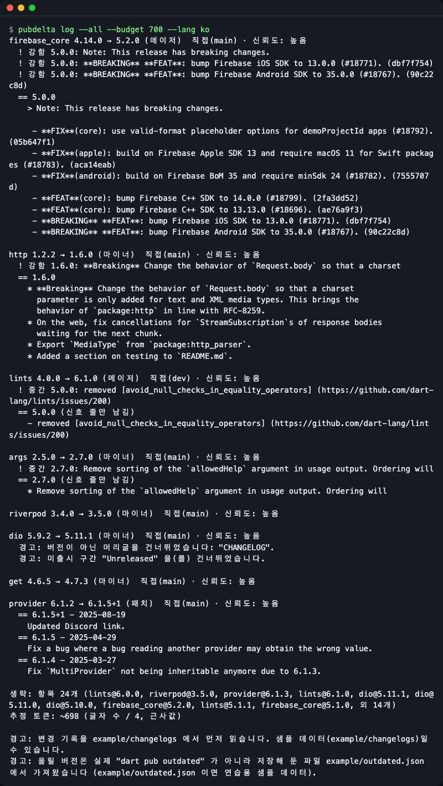
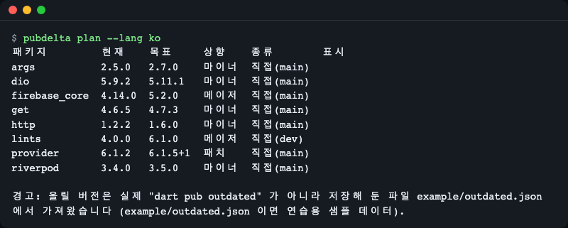
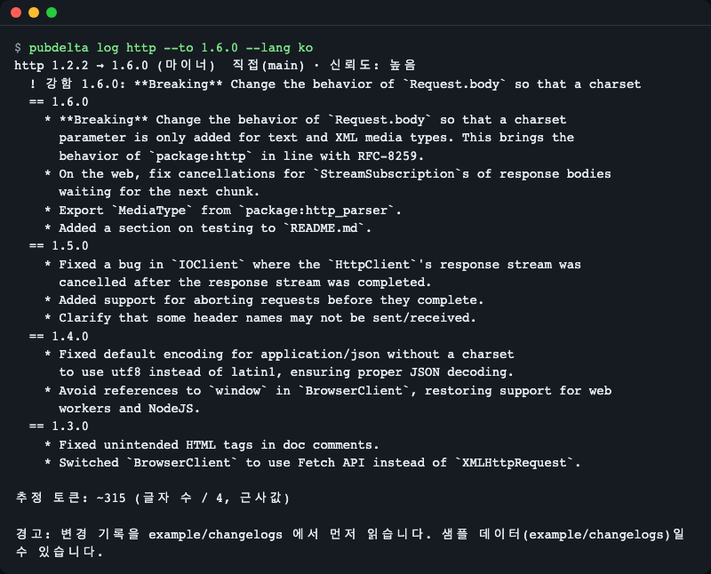
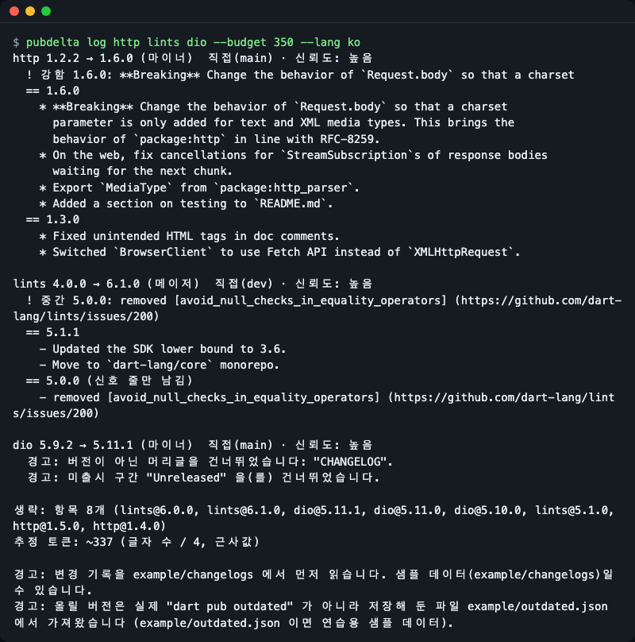
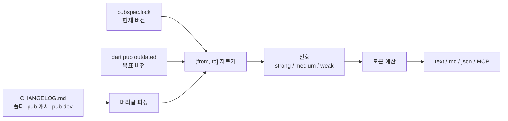

# pubdelta

[English](README.md) | **한국어**

pubdelta 는 `pubspec.lock` 에 고정된 버전 다음부터 올리려는 버전까지의 CHANGELOG 항목만 잘라, 깨지는 변경 신호가 강한 순서로 보여 줍니다. `dart pub upgrade --major-versions` 를 누르기 직전의 Dart·Flutter 개발자와 그 프로젝트에서 일하는 코딩 에이전트를 위한 도구이며, CLI 와 MCP 서버(`pubdelta mcp`)가 한 실행 파일에 들어 있습니다.

`dart pub outdated` 에 노란 줄이 열 개쯤 쌓이면, 패키지마다 pub.dev 변경 기록 탭을 열어 현재 버전 머리글을 손으로 찾고 그 위쪽만 읽는 일이 번거롭습니다. pubdelta 가 모든 패키지에 대해 그 자르기를 한 번에 해 줍니다.


*`pubdelta log --all --budget 700`: 패키지마다 `현재 → 목표`, `강함` 으로 표시된 깨지는 줄, 그리고 현재 버전 다음 항목만 나옵니다.*

## 이런 분께

- `dart pub upgrade --major-versions` 를 누르기 전에 무엇이 바뀌는지 먼저 알고 싶은 분
- 코딩 에이전트에게 "의존성 올려 줘"를 시키면서, 패키지마다 변경 기록 전체가 컨텍스트에 쏟아지는 것은 싫은 분
- CI 에서 의존성 상향을 검토하고, 변경 기록에 `**Breaking**` 이 있으면 종료 코드로 알고 싶은 분

## 설치

Dart SDK 3.7 이상이 필요합니다(3.8.1 에서 확인). Flutter 에 포함되어 있습니다.

```bash
# Dart SDK: https://dart.dev/get-dart
dart pub global activate --source git https://github.com/LeeGyeongPil/pubdelta
# 또는 설치 없이 clone 해서 실행:
git clone https://github.com/LeeGyeongPil/pubdelta && cd pubdelta && dart pub get
```

`dart pub global activate` 뒤에는 pub 캐시의 `bin` 폴더(`~/.pub-cache/bin`)가 `PATH` 에 있어야 `pubdelta` 로 부를 수 있습니다. clone 한 폴더에서는 아래 모든 명령의 `pubdelta` 를 `dart run bin/pubdelta.dart` 로 바꿔 쓰세요. 최소 리눅스 이미지에서는 SDK 를 받으려면 `git`·`curl` 도 필요합니다.

## 빠르게 시작하기

`example/` 에 연습용(목, mock) 자료가 들어 있습니다: 잠금 파일, 저장해 둔 `dart pub outdated --json` 결과, 실제 패키지 CHANGELOG 발췌. 네트워크 없이 돌아갑니다. 발췌 본문은 실제 파서를 그대로 통과하고, 다른 점은 "어떤 버전이 올릴 수 있는가" 입력이 실제 `dart pub outdated` 대신 저장된 파일이라는 것뿐이며, 도구가 stderr 에 "샘플 데이터일 수 있다"는 경고를 냅니다. 실제 모드(`--outdated`·`--changelog-dir` 없이)는 pub.dev 에 물어보므로 패키지 수와 pub.dev 응답에 따라 수십 초 걸릴 수 있습니다.

```bash
dart run bin/pubdelta.dart plan --lock example/pubspec.lock --outdated example/outdated.json --lang ko
```

```
패키지         현재    목표     상향    종류        표시
args           2.5.0   2.7.0    마이너  직접(main)
dio            5.9.2   5.11.1   마이너  직접(main)
firebase_core  4.14.0  5.2.0    메이저  직접(main)
get            4.6.5   4.7.3    마이너  직접(main)
http           1.2.2   1.6.0    마이너  직접(main)
lints          4.0.0   6.1.0    메이저  직접(dev)
provider       6.1.2   6.1.5+1  패치    직접(main)
riverpod       3.4.0   3.5.0    마이너  직접(main)
```

(명령은 마지막에 "샘플 데이터" 경고 줄도 stderr 로 냅니다.)


*`plan` 은 올릴 수 있는 모든 패키지의 현재 버전·목표 버전·상향 크기·의존성 종류를 보여 줍니다.*

직접 의존성(`main`·`dev`)은 항상 나옵니다. 간접 의존성까지 보려면 `--include transitive` 를 더하세요. 예제 자료에서는 `async`(2.13.0 → 2.13.1, 패치, 전이) 한 줄이 늘어납니다.

이제 핵심인 한 패키지의 변경 기록입니다.

```bash
dart run bin/pubdelta.dart log http --to 1.6.0 --lock example/pubspec.lock --changelog-dir example/changelogs --lang ko
```

```
http 1.2.2 → 1.6.0 (마이너)  직접(main) · 신뢰도: 높음
  ! 강함 1.6.0: **Breaking** Change the behavior of `Request.body` so that a charset
  == 1.6.0
    * **Breaking** Change the behavior of `Request.body` so that a charset
      parameter is only added for text and XML media types. This brings the
      behavior of `package:http` in line with RFC-8259.
    * On the web, fix cancellations for `StreamSubscription`s of response bodies
      waiting for the next chunk.
    * Export `MediaType` from `package:http_parser`.
    * Added a section on testing to `README.md`.
  == 1.5.0
    * Fixed a bug in `IOClient` where the `HttpClient`'s response stream was
      cancelled after the response stream was completed.
    * Added support for aborting requests before they complete.
    * Clarify that some header names may not be sent/received.
  == 1.4.0
    * Fixed default encoding for application/json without a charset
      to use utf8 instead of latin1, ensuring proper JSON decoding.
    * Avoid references to `window` in `BrowserClient`, restoring support for web
      workers and NodeJS.
  == 1.3.0
    * Fixed unintended HTML tags in doc comments.
    * Switched `BrowserClient` to use Fetch API instead of `XMLHttpRequest`.

추정 토큰: ~315 (글자 수 / 4, 근사값)
```

(이미 쓰고 있는 1.2.2 항목은 없습니다. 머리 줄과 라벨(`강함`·`마이너`·`신뢰도: 높음`)은 한국어이고 변경 기록 본문은 원문 그대로입니다. "샘플 데이터" 경고 줄은 stderr 로 나옵니다.) `http` 는 버전 번호로는 1.2.2 에서 1.6.0 으로 마이너 상향이지만 1.6.0 에 `**Breaking**` 줄이 있습니다. pubdelta 는 번호가 아니라 본문에서 그것을 찾아냅니다.


*강한 신호가 맨 위에 올라오고, 그 아래로 1.6.0·1.5.0·1.4.0·1.3.0 항목이 나옵니다. 1.2.2 는 나오지 않습니다.*

전체를 토큰 예산에 맞춰 한 번에 보는 것이 시작 명령입니다.

```bash
dart run bin/pubdelta.dart log --all --lock example/pubspec.lock --outdated example/outdated.json --changelog-dir example/changelogs --budget 2500 --lang ko
```

종료 코드 0, 첫 패키지는 `firebase_core`(`강함 5.0.0`, 깨지는 줄 3개), 그다음 `http` 이고, 끝에 `생략: 항목 14개 (...)` 와 `추정 토큰: ~2496 (글자 수 / 4, 근사값)` 가 나옵니다. 같은 명령에 `--fail-on breaking` 을 붙이면 종료 코드 1 입니다.

## 사용법

| 명령·옵션 | 하는 일 | 예 |
|---|---|---|
| `plan` | 올릴 수 있는 패키지 목록: 현재·목표·상향 크기(0.x 마이너는 메이저로 셈)·종류·retracted·discontinued·advisory 표시 | `pubdelta plan` |
| `log <패키지>… \| --all` | (현재, 목표] 구간 항목만 신호 순으로 출력 | `pubdelta log http dio` |
| `--from`, `--to` | 현재·목표 버전 직접 지정(패키지 하나일 때만) | `pubdelta log http --to 1.6.0` |
| `--lock <file>` | `pubspec.lock` 경로(기본 `pubspec.lock`) | `--lock app/pubspec.lock` |
| `--outdated <file.json>` | `dart pub outdated --json` 를 실행하는 대신 저장한 파일 사용 | `--outdated outdated.json` |
| `--mode upgradable\|resolvable\|latest` | outdated 의 어느 열을 목표로 쓸지(기본 `resolvable`) | `--mode latest` |
| `--include transitive` | 간접(전이) 의존성도 함께 보여 줌. 직접 main·dev 는 항상 포함되고, `dev` 값은 받기는 하지만 바뀌는 것이 없음 | `--include transitive` |
| `--changelog-dir <dir>` | `<패키지>.md` 변경 기록을 폴더에서 가장 먼저 읽음 | `--changelog-dir notes/` |
| `--offline` | 네트워크 없이 pub 캐시와 `--changelog-dir` 만 사용 | `--offline` |
| `--budget <tokens>` | 출력을 대략 이 토큰 수로 줄임(글자 수 / 4, 추정값) | `--budget 2500` |
| `--format text\|md\|json` | 출력 형식 | `--format md > upgrade-notes.md` |
| `--fail-on none\|breaking\|major` | 강한 깨지는 신호가 있거나(`major` 는 메이저 상향이 있어도) 종료 코드 1 | `--fail-on breaking` |
| `--lang en\|ko` | 출력 언어([화면 언어](#화면-언어) 참고) | `--lang ko` |
| `mcp` | `plan`·`changelog` 도구를 가진 MCP 서버를 stdio 로 실행([코딩 에이전트에서 쓰기](#코딩-에이전트에서-쓰기-mcp) 참고) | `pubdelta mcp` |

이름으로 지정한 패키지(`pubdelta log lints`)는 종류와 상관없이 찾습니다. `pubdelta <명령> --help` 를 실행하면 모든 옵션과 기본값이 나옵니다.

**신호를 읽는 방법.** 버전 번호가 아니라 각 항목의 본문을 훑습니다.

| 등급(화면 표시) | 잡는 것 | 예 |
|---|---|---|
| strong(`강함`) | `BREAKING`, 굵은 `**Breaking**`, `### Breaking Changes` 소절, melos `> Note: This release has breaking changes.` | http 1.6.0 |
| medium(`중간`) | `Removed` 로 시작하는 목록 항목, `breaking change` 구절 | lints 5.0.0 |
| weak(`약함`) | `Deprecated`, `deprecate` | |

등급 옆에 항상 원문 줄을 같이 보여 줍니다. 등급은 휴리스틱이라 기록에 적히지 않은 깨짐은 놓칠 수 있고, 소문자 `breaking` 하나만으로는 신호로 치지 않습니다. 판단은 사용자 몫이고 pubdelta 는 근거를 줍니다.

**종료 코드.**

| 코드 | 뜻 |
|---|---|
| 0 | 정상 |
| 1 | `--fail-on` 에 해당 |
| 2 | 사용법 오류(없는 옵션, 허용되지 않은 값) |
| 3 | 입력 오류: 잠금 파일이 없거나 읽을 수 없거나 올바른 UTF-8 이 아님, 또는 옵션으로 준 파일을 읽을 수 없음 |
| 4 | 변경 기록을 얻지 못함. 패키지 블록에 원인과 해 볼 방법이 나옴 |
| 5 | `dart pub outdated` 와 대체 방법이 모두 실패했거나 `--outdated` 파일이 올바른 결과가 아님 |
| 6 | 예상하지 못한 내부 오류. pubdelta 의 버그이며, 스택 트레이스 대신 한 줄로 알려 줍니다. 실행한 명령과 함께 알려 주세요 |

오류는 항상 고른 언어로 한 줄씩 나오고 스택 트레이스는 나오지 않습니다.

**예산.** `--budget` 은 중요한 항목부터(strong, medium, 새 메이저, weak, 나머지, 같은 등급은 최신 우선) 담고, 빠진 항목은 모두 `생략` 줄에 나열해 조용히 사라지는 것이 없게 합니다.

```bash
dart run bin/pubdelta.dart log http lints dio --lock example/pubspec.lock --outdated example/outdated.json --changelog-dir example/changelogs --budget 350 --lang ko
```

```
http 1.2.2 → 1.6.0 (마이너)  직접(main) · 신뢰도: 높음
  ! 강함 1.6.0: **Breaking** Change the behavior of `Request.body` so that a charset
  == 1.6.0
    * **Breaking** Change the behavior of `Request.body` so that a charset
      parameter is only added for text and XML media types. This brings the
      behavior of `package:http` in line with RFC-8259.
    * On the web, fix cancellations for `StreamSubscription`s of response bodies
      waiting for the next chunk.
    * Export `MediaType` from `package:http_parser`.
    * Added a section on testing to `README.md`.
  == 1.3.0
    * Fixed unintended HTML tags in doc comments.
    * Switched `BrowserClient` to use Fetch API instead of `XMLHttpRequest`.

lints 4.0.0 → 6.1.0 (메이저)  직접(dev) · 신뢰도: 높음
  ! 중간 5.0.0: removed [avoid_null_checks_in_equality_operators] (https://github.com/dart-lang/lints/issues/200)
  == 5.1.1
    - Updated the SDK lower bound to 3.6.
    - Move to `dart-lang/core` monorepo.
  == 5.0.0 (신호 줄만 남김)
    - removed [avoid_null_checks_in_equality_operators] (https://github.com/dart-lang/lints/issues/200)

dio 5.9.2 → 5.11.1 (마이너)  직접(main) · 신뢰도: 높음
  경고: 버전이 아닌 머리글을 건너뛰었습니다: "CHANGELOG".
  경고: 미출시 구간 "Unreleased" 을(를) 건너뛰었습니다.

생략: 항목 8개 (lints@6.0.0, lints@6.1.0, dio@5.11.1, dio@5.11.0, dio@5.10.0, lints@5.1.0, http@1.5.0, http@1.4.0)
추정 토큰: ~337 (글자 수 / 4, 근사값)
```


*예산이 작으면 강한 신호가 있는 항목부터 담고, 통째로 안 들어가는 항목은 신호 줄만 남기며(`신호 줄만 남김`), 나머지는 패키지 머리 줄과 `생략` 줄에만 남습니다. 머리 줄 자체는 줄일 수 없습니다.*

## 화면 언어

메시지·표 머리·라벨은 영어와 한국어로 나옵니다. 언어는 `--lang en|ko`, 그다음 `PUBDELTA_LANG`, `LC_ALL`, `LC_MESSAGES`, `LANG` 순서로 정합니다. `ko` 로 시작하지 않으면 영어입니다. JSON 키와 변경 기록 본문은 번역하지 않습니다. 사용법 오류도 같은 언어를 따릅니다.

```bash
dart run bin/pubdelta.dart log http --bogus --lang ko
```

```
pubdelta: "pubdelta log" 에 없는 옵션입니다: "--bogus"
사용법은 "pubdelta --help" 로 확인하세요.
```

이 출력은 stderr 로 나오고 종료 코드는 2 입니다. `--lang en` 이면 같은 오류가 `pubdelta: "pubdelta log" has no option "--bogus"` 로 나옵니다.

## 설정

| 설정 | 뜻 |
|---|---|
| `PUBDELTA_LANG` | 출력 언어. [화면 언어](#화면-언어) 참고. |
| `PUBDELTA_HOSTED_URL` | 변경 기록 아카이브를 받을 hosted 저장소(미러). 기본은 잠금 파일의 주소. |
| `PUB_CACHE` | pub 캐시 위치(기본 `~/.pub-cache`, Windows `%LOCALAPPDATA%\Pub\Cache`). 내려받기 전에 먼저 찾습니다. |
| `PUB_HOSTED_URL` | pub 표준 변수. `dart pub outdated` 에 그대로 전달됩니다. |

API 키는 필요 없습니다. 변경 기록 찾는 순서: `--changelog-dir`, pub 캐시, hosted 아카이브(`/api/packages/<pkg>` 의 `archive_url`). `path` 의존성은 로컬 CHANGELOG 를 읽고("구간 불명") `git`·`sdk` 의존성은 "변경 기록 없음"으로 표시합니다.

## 오프라인·프록시 환경

- `--offline` 은 변경 기록을 찾을 때 네트워크를 쓰지 않게 합니다. 이때 변경 기록은 `--changelog-dir` 와 pub 캐시에서만 읽으므로, pub 캐시에 패키지마다 **목표** 버전(또는 그보다 새 버전)이 이미 있어야 합니다. `dart pub get` 은 잠금 파일에 고정된 버전만 받으므로 이것으로는 부족합니다. 네트워크가 될 때 `dart pub cache add <패키지> --version <목표 버전>` 으로 목표 버전을 캐시에 받아 두세요. `--offline` 은 목표 버전을 정하는 방법을 바꾸지 않으니, 네트워크를 전혀 쓰지 않으려면 `--outdated <file.json>` 도 함께 주세요.
- `dart pub outdated` 에는 오프라인 옵션이 없습니다. 실패하면(네트워크 없음, TLS 를 가로채는 프록시) pubdelta 가 `dart pub upgrade --offline --dry-run --major-versions` 로 대체하고 경고로 알려 주며, 둘 다 실패할 때만 종료 코드 5 로 끝납니다. 저장해 둔 `--outdated outdated.json` 을 주면 이 단계를 건너뜁니다.
- 변경 기록 아카이브를 받지 못하면 패키지 블록에 원인과 대안(`--changelog-dir`, `PUBDELTA_HOSTED_URL`, 또는 목표 버전을 받아 둔 pub 캐시와 `--offline`)을 보여 주고 종료 코드 4 로 끝납니다.

캐시에 목표 버전이 없으면 `--offline` 이 받을 명령을 그대로 알려 줍니다(여기서는 빈 pub 캐시).

```bash
dart run bin/pubdelta.dart log http --to 1.6.0 --lock example/pubspec.lock --offline --lang ko
```

```
http 1.2.2 → 1.6.0 (마이너)  직접(main) · 신뢰도: 없음
  경고: http: 목표 버전 1.6.0 이(가) pub 캐시에 없고 --offline 이 켜져 있습니다. "dart pub cache add http --version 1.6.0" 로 캐시에 받거나 --changelog-dir 을 주세요.

추정 토큰: ~53 (글자 수 / 4, 근사값)
패키지 1개의 변경 기록을 얻지 못했습니다 (http). 위 경고를 확인하세요. 종료 코드 4.
```

마지막 줄은 stderr 로 나오고 종료 코드는 4 입니다. pub 캐시에 `http-1.6.0` 이 들어오면 같은 명령이 1.6.0~1.3.0 항목을 보여 주고 종료 코드 0 으로 끝납니다.

## 코딩 에이전트에서 쓰기 (MCP)

`pubdelta mcp` 는 stdio 로 동작하는 MCP 서버입니다. MCP 클라이언트가 이 명령을 자식 프로세스로 띄우고, 한 줄에 JSON-RPC 메시지 하나씩 주고받습니다. 쓰는 MCP 클라이언트의 서버 설정 파일에 등록하세요. JSON 설정을 쓰는 클라이언트는 보통 아래와 같은 `mcpServers` 객체를 받습니다.

```json
{
  "mcpServers": {
    "pubdelta": {
      "command": "pubdelta",
      "args": ["mcp"],
      "env": { "PUBDELTA_LANG": "en" }
    }
  }
}
```

- 다른 형식(예: TOML)의 설정 파일을 쓰는 클라이언트에도 같은 세 값을 넣습니다: 명령 `pubdelta`, 인수 `mcp`, 환경 변수 `PUBDELTA_LANG=en`. 키 이름은 클라이언트 문서를 확인하세요.
- 어떤 클라이언트는 셸의 `PATH` 없이 서버를 띄웁니다. `pubdelta` 를 찾지 못한다고 나오면 `command` 에 pub 캐시 `bin` 폴더의 `pubdelta` 전체 경로를 적으세요.
- 설치 없이 clone 해서 쓸 때는 `"command": "dart"`, `"args": ["run", "/path/to/pubdelta/bin/pubdelta.dart", "mcp"]` 로 쓰고 `/path/to/pubdelta` 를 clone 한 폴더의 절대 경로로 바꾸세요. 스크립트 경로를 기준으로 패키지를 찾으므로 클라이언트의 작업 폴더와 상관없이 동작합니다.

서버가 응답하는지는 레포 폴더에서 이렇게 확인합니다.

```bash
printf '%s\n' '{"jsonrpc":"2.0","id":1,"method":"initialize","params":{"protocolVersion":"2025-06-18","capabilities":{},"clientInfo":{"name":"try","version":"0"}}}' '{"jsonrpc":"2.0","id":2,"method":"tools/list"}' | dart run bin/pubdelta.dart mcp
```

JSON 두 줄이 나옵니다(여기서는 앞부분만).

```
{"jsonrpc":"2.0","id":1,"result":{"protocolVersion":"2025-06-18","capabilities":{"tools":{
{"jsonrpc":"2.0","id":2,"result":{"tools":[{"name":"plan","description":"List the packages
```

| 도구 | 인수(모두 선택) | 돌려주는 것 |
|---|---|---|
| `plan` | `projectDir`, `mode`, `include` | `pubdelta plan --format md` 와 같은 목록 |
| `changelog` | `projectDir`, `packages`, `from`, `to`, `budget`, `format`(`md` 또는 `json`), 연습용 모드를 위한 `offline`, `changelogDir`, `outdatedFile` | `pubdelta log --format md` 와 같은 Markdown(또는 JSON) |

서버는 `initialize`·`ping`·`tools/list`·`tools/call` 에 답합니다. 호출 하나가 실패하면 그 응답만 `isError: true` 이고, 서버는 다음 요청에 계속 답합니다. 직접 쓴 작은 JSON-RPC 서버이고 자식 프로세스 왕복 테스트로 확인했으며, 실제 MCP 클라이언트로는 아직 시험하지 않았습니다. 응답 언어는 서버 프로세스의 `PUBDELTA_LANG`·`LANG` 을 따르므로 위 예처럼 `PUBDELTA_LANG=en` 을 넣어 두면 에이전트가 읽기 쉽습니다. 도구 설명은 항상 영어입니다.

## 동작 원리



- 잠금 파일은 지금 쓰는 버전, outdated 는 올릴 수 있는 버전, 변경 기록은 그 사이의 영수증 묶음입니다. pubdelta 는 마지막 정산 이후의 영수증만 읽습니다.
- `## 1.6.0`, `## 3.5.0 - 2026-11-06`, `## 6.1.3 (retracted)`, `## [4.7.3]`, `# v1.2.0`, `## 6.1.5+1`, 프리릴리스 머리글을 모두 이해하고 `## Unreleased` 는 뺍니다.
- 버전 머리글이 하나도 없는 파일은 앞 40줄(파일이 더 짧으면 전체, 빈 파일이면 빈 발췌)과 낮은 신뢰도(`신뢰도: 낮음`)로 대신합니다.
- 버전은 `pub_semver` 로 비교하므로 `6.1.5+1` 은 `6.1.5` 다음입니다.

## 한계

- 토큰 수는 실제 토크나이저가 아니라 추정값(글자 수 / 4)입니다. 패키지 머리 줄은 줄일 수 없어서 예산이 아주 작으면 넘을 수 있습니다.
- 글자 수로 추정하므로 같은 예산이라도 영어와 한국어 출력에 담기는 항목이 조금 다를 수 있습니다(위 350 예산 예에서 한국어 출력에는 http 1.3.0 이 들어갑니다).
- 신호는 휴리스틱입니다(위 신호 표 참고). 변경 기록에 적히지 않은 깨지는 변경은 찾지 못합니다.
- `path` 의존성은 버전 이력이 없어 "구간 불명", `git`·`sdk` 의존성은 변경 기록이 없습니다.
- MCP 서버는 아직 자식 프로세스 왕복 테스트로만 확인했습니다.

## 다른 도구와 비교

- 공식 Dart·Flutter MCP 서버인 [dart_mcp_server](https://github.com/dart-lang/ai/tree/main/pkgs/dart_mcp_server) 는 pub 명령 실행과 pub.dev 검색을 하지만 변경 기록 도구는 없습니다. 이를 더해 달라는 요청이 열려 있고([dart-lang/ai#264](https://github.com/dart-lang/ai/issues/264)), pubdelta 는 그 빈자리를 채우며 함께 띄워 쓸 수 있습니다. (2026-11-21 확인)
- [changelog_bubbler](https://pub.dev/packages/changelog_bubbler) 0.2.1 은 두 git ref 사이에 바뀐 의존성의 변경 기록을 모읍니다(즉 올린 뒤). [pubspeccheck](https://pub.dev/packages/pubspeccheck) 0.1.1 은 메이저 업데이트를 링크 수준으로 알립니다. 둘 다 SDK 3.0.0 미만을 요구해 Dart 3 에서 돌지 않습니다. (2026-11-21 pub.dev API 로 확인)
- [Dependabot](https://docs.github.com/en/code-security/dependabot)·[Renovate](https://docs.renovatebot.com/) 는 호스팅된 저장소에 업그레이드 PR 을 엽니다. 자동 PR 은 그쪽을 쓰고, pubdelta 는 올리기 전에 로컬에서 보는 용도이며 CI 에서 `--fail-on breaking` 으로 그런 PR 을 표시할 수 있습니다.
- `dart pub outdated` 는 변경 기록 없이 오래된 패키지 목록만 보여 줍니다. pubdelta 는 그 결과를 입력으로 씁니다.

잘 맞는 때: 올리기 전에 잠금 파일 전체의 변경점을 로컬에서 보고 싶을 때, 에이전트가 파일 전체 대신 필요한 구간만 읽게 하고 싶을 때.

## 자주 겪는 문제

| 증상 | 원인 | 해결 |
|---|---|---|
| `종료 코드 4` 와 `TLS 오류` 경고 | pub.dev 아카이브를 못 받음(TLS·프록시·네트워크 없음) | `--changelog-dir` 사용, `PUBDELTA_HOSTED_URL` 에 미러 지정, 또는 목표 버전을 pub 캐시에 받아 두고(`dart pub cache add <패키지> --version <목표 버전>`) `--offline` 추가 |
| `종료 코드 4` 와 `pub 캐시에 없고 --offline 이 켜져 있습니다` | `--offline` 인데 캐시에 예전 버전만 있음 | 경고에 나온 `dart pub cache add` 명령을 실행하거나 `--changelog-dir` 사용 |
| `종료 코드 4` 와 `저장소 주소가 올바르지 않습니다` | `PUBDELTA_HOSTED_URL`(또는 잠금 파일의 hosted URL)에 `http://`·`https://` 가 없음 | `https://pub.dev` 처럼 전체 주소로 지정 |
| 종료 코드 5 | `dart pub outdated` 와 오프라인 대체가 모두 실패했거나 `--outdated` 파일이 올바른 결과가 아님 | `dart pub outdated --json` 으로 다시 저장한 결과를 `--outdated outdated.json` 으로 전달 |
| `잠금 파일 … 을(를) 읽을 수 없습니다: 파일이 올바른 UTF-8 텍스트가 아닙니다`, 종료 코드 3 | 잠금 파일이 다른 인코딩으로 저장됐거나 손상됨 | `dart pub get` 으로 다시 만들기 |
| `CHANGELOG 가 올바른 UTF-8 이 아니어서` 경고 | 패키지 변경 기록이 다른 인코딩임 | 할 일 없음. 실행은 계속되고 읽지 못한 글자는 `�` 로 나옴 |
| `예상하지 못한 오류 (…)`, 종료 코드 6 | pubdelta 의 버그 | 실행한 명령과 그 줄을 이슈로 남겨 주세요 |
| `에 없는 옵션입니다`·`쓸 수 없는 값입니다`, 종료 코드 2 | 옵션 이름 오타나 허용되지 않은 값 | `pubdelta <명령> --help` 로 옵션과 가능한 값 확인 |
| 출력이 한국어로 나옴 | `LANG` 이 `ko` 로 시작 | `--lang en` 또는 `PUBDELTA_LANG=en` |
| `신뢰도: 낮음` | 변경 기록에 버전 머리글이 없음 | 출력된 앞부분을 읽거나 `--changelog-dir` 로 다른 기록 지정 |
| `생략` 에 항목이 많음 | 예산이 작음 | `--budget` 을 올림 |
| "샘플 데이터" 경고 | `example/` 파일을 썼음 | 연습 모드에서는 정상. 실제 자료는 `--outdated`·`--changelog-dir` 를 빼세요 |
| MCP 클라이언트가 서버를 띄우지 못함 | 클라이언트가 쓰는 `PATH` 에 `pubdelta` 가 없음 | `command` 에 전체 경로를 쓰거나 [코딩 에이전트에서 쓰기](#코딩-에이전트에서-쓰기-mcp) 의 `dart run` 방식 사용 |

## 더 알아보기

- [`dart pub outdated`](https://dart.dev/tools/pub/cmd/pub-outdated): `--mode` 가 고르는 current·upgradable·resolvable·latest 열의 뜻.
- [`dart pub upgrade`](https://dart.dev/tools/pub/cmd/pub-upgrade): 오프라인 대체에 쓰는 `--major-versions`·`--dry-run`.
- [pub_semver](https://pub.dev/packages/pub_semver): pubdelta 가 따르는 버전 정렬 규칙(프리릴리스·빌드 번호).
- [dart-lang/ai#264](https://github.com/dart-lang/ai/issues/264): 에이전트용 변경 기록 도구가 무엇을 해야 하는지에 대한 논의.

## 개발·기여

CI 가 돌리는 네 단계와 같은 명령, 같은 순서입니다:

```bash
dart pub get
dart format --output=none --set-exit-if-changed .
dart analyze
dart test
```

`dart test` 는 네트워크도 키도 필요 없습니다: 127.0.0.1 에 가짜 pub 저장소를 띄웁니다. 시험 1개는 기본으로 건너뜁니다(`~1`). 이유는 마지막 줄 옆이 아니라 진행 출력 중간, 그 시험 이름 바로 아래에 나옵니다(줄임, 시간은 실행마다 다름):

```
00:00 +106: test/plan_test.dart: real `dart pub outdated --json` against a fake repository runs end to end with PUB_HOSTED_URL
  Skip: Starts the SDK's real `dart pub`. Run with: dart test --run-skipped -t integration
...
00:06 +193 ~1: All tests passed!
```

건너뛴 시험에는 `integration` 태그가 붙어 있습니다. SDK 의 실제 `dart pub outdated` 를 로컬 가짜 저장소에 붙여 돌립니다. pub 동작은 SDK 버전에 따라 달라질 수 있어서 `dart_test.yaml` 이 기본 실행과 CI 에서 뺍니다. 직접 돌리려면(Dart 3.8.1 에서 확인):

```bash
dart test --run-skipped -t integration
```

CI 는 Dart SDK 를 3.8.1 로 고정합니다(`.github/workflows/ci.yml`). 포매터와 분석기가 SDK 에 들어 있어서, SDK 가 바뀌면 같은 코드도 결과가 달라질 수 있기 때문입니다. 다른 SDK 로 옮길 때는 `ci.yml` 과 `test/ci_workflow_test.dart` 의 `pinnedSdk` 를 함께 고칩니다.

버그·제안은 이슈로 남겨 주세요. 변경 기록은 [CHANGELOG.md](CHANGELOG.md).

## 라이선스

MIT. `example/changelogs/` 의 변경 기록 발췌는 원 패키지 변경 기록의 짧은 인용입니다(BSD-3-Clause 또는 MIT, `example/changelogs/NOTICE.md` 참고).
