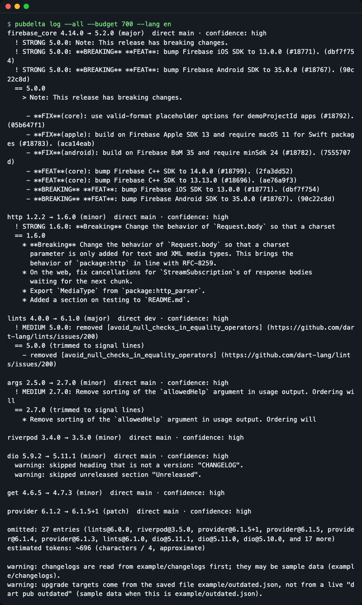
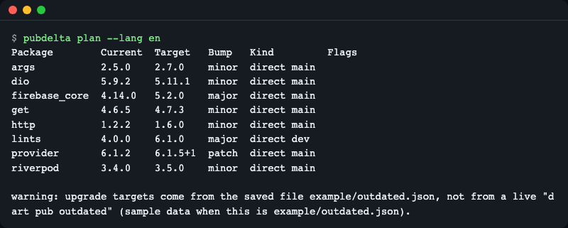
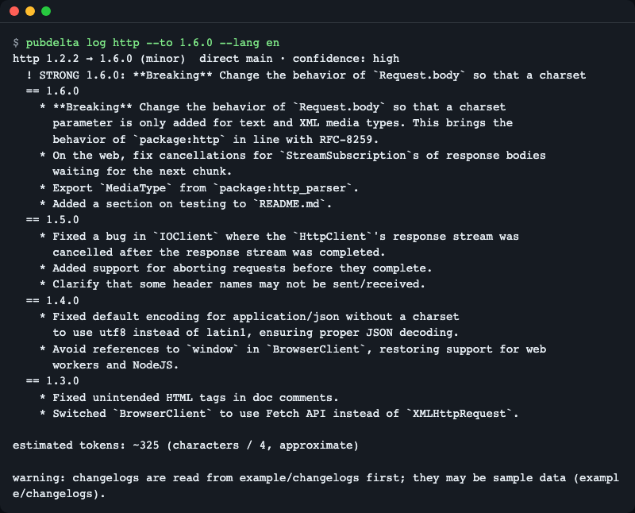
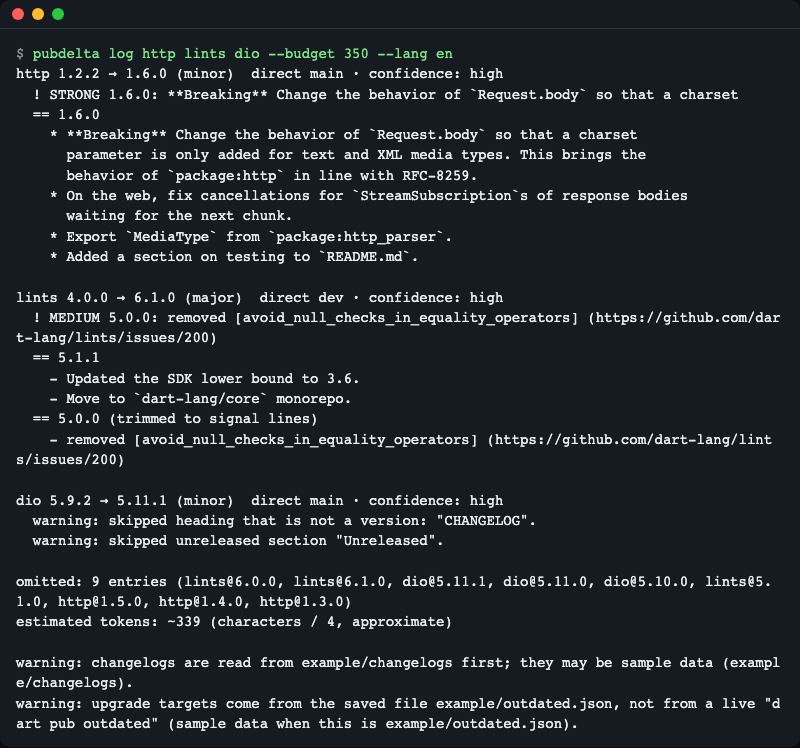
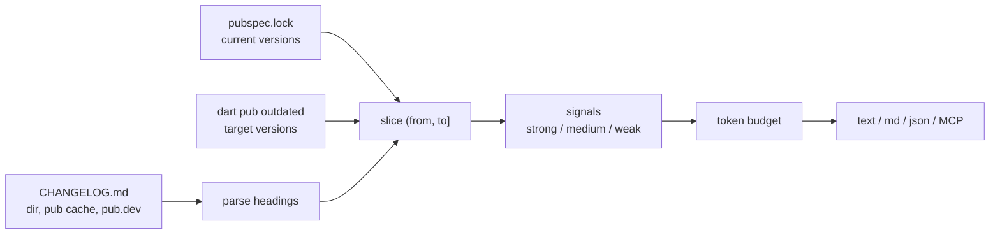

# pubdelta

**English** | [한국어](README.ko.md)

pubdelta prints only the CHANGELOG entries between the version your `pubspec.lock` pins and the version you are about to upgrade to, with breaking-change signals first. It is for Dart and Flutter developers, and for the coding agents working in their projects, right before `dart pub upgrade --major-versions`. It ships as a CLI and as an MCP server (`pubdelta mcp`) in one binary.

Opening a package's pub.dev changelog tab, finding your current version heading by hand and reading only what is above it gets old fast when `dart pub outdated` shows a dozen yellow lines. pubdelta does that cut for every package at once.


*`pubdelta log --all --budget 700`: each package shows `current → target`, the `STRONG` breaking lines first, then only the entries after your current version.*

## Who this is for

- You are about to run `dart pub upgrade --major-versions` and want to know what changes first.
- You ask a coding agent to "upgrade my dependencies" and do not want the whole changelog of every package pasted into the context.
- You review dependency bumps in CI and want a non-zero exit code when a changelog says `**Breaking**`.

## Install

pubdelta needs the Dart SDK 3.7 or newer (checked with 3.8.1). Flutter ships one.

```bash
# Dart SDK: https://dart.dev/get-dart
dart pub global activate --source git https://github.com/LeeGyeongPil/pubdelta
# or run from a clone, with no install:
git clone https://github.com/LeeGyeongPil/pubdelta && cd pubdelta && dart pub get
```

After `dart pub global activate`, make sure the pub cache `bin` folder (`~/.pub-cache/bin`) is on your `PATH`, then use `pubdelta`. In a clone, replace `pubdelta` with `dart run bin/pubdelta.dart` in every command below. On a minimal Linux image you also need `git` and `curl` to install the SDK.

## Quick start

The repository ships a practice (mock) data set in `example/`: a lock file, a saved `dart pub outdated --json` result and real CHANGELOG excerpts. It runs with no network. The excerpts go through the real parser; only the "which versions are outdated" input is a saved file instead of a live `dart pub outdated`, and the tool prints a warning to stderr that it may be sample data. Real mode (no `--outdated`, no `--changelog-dir`) asks pub.dev and may take tens of seconds, depending on the package count and pub.dev's response time.

```bash
dart run bin/pubdelta.dart plan --lock example/pubspec.lock --outdated example/outdated.json --lang en
```

```
Package        Current  Target   Bump   Kind         Flags
args           2.5.0    2.7.0    minor  direct main
dio            5.9.2    5.11.1   minor  direct main
firebase_core  4.14.0   5.2.0    major  direct main
get            4.6.5    4.7.3    minor  direct main
http           1.2.2    1.6.0    minor  direct main
lints          4.0.0    6.1.0    major  direct dev
provider       6.1.2    6.1.5+1  patch  direct main
riverpod       3.4.0    3.5.0    minor  direct main
warning: upgrade targets come from the saved file example/outdated.json, not from a live "dart pub outdated" (sample data when this is example/outdated.json).
```


*`plan` lists every package with a newer version: current, target, bump size and dependency kind.*

Direct `main` and `dev` dependencies are always listed. Add `--include transitive` to also see indirect ones; with the example data that adds one line for `async` (2.13.0 → 2.13.1, patch, transitive).

Now the part that matters, the changelog for one package:

```bash
dart run bin/pubdelta.dart log http --to 1.6.0 --lock example/pubspec.lock --changelog-dir example/changelogs --lang en
```

```
http 1.2.2 → 1.6.0 (minor)  direct main · confidence: high
  ! STRONG 1.6.0: **Breaking** Change the behavior of `Request.body` so that a charset
  == 1.6.0
    * **Breaking** Change the behavior of `Request.body` so that a charset
      parameter is only added for text and XML media types. This brings the
      behavior of `package:http` in line with RFC-8259.
    * On the web, fix cancellations for `StreamSubscription`s of response bodies
      waiting for the next chunk.
    * Export `MediaType` from `package:http_parser`.
    * Added a section on testing to `README.md`.
  == 1.5.0
    * Fixed a bug in `IOClient` where the `HttpClient`'s response stream was
      cancelled after the response stream was completed.
    * Added support for aborting requests before they complete.
    * Clarify that some header names may not be sent/received.
  == 1.4.0
    * Fixed default encoding for application/json without a charset
      to use utf8 instead of latin1, ensuring proper JSON decoding.
    * Avoid references to `window` in `BrowserClient`, restoring support for web
      workers and NodeJS.
  == 1.3.0
    * Fixed unintended HTML tags in doc comments.
    * Switched `BrowserClient` to use Fetch API instead of `XMLHttpRequest`.

estimated tokens: ~325 (characters / 4, approximate)
```

(The sample-data warning goes to stderr. There is no `1.2.2` entry because you already run it.) `http` goes from 1.2.2 to 1.6.0, a minor bump by version number, yet 1.6.0 contains a `**Breaking**` line. pubdelta finds it in the text, not in the number.


*The strong signal is lifted to the top, then entries 1.6.0, 1.5.0, 1.4.0 and 1.3.0. 1.2.2 is not shown.*

Everything at once, trimmed to a token budget, is the start command:

```bash
dart run bin/pubdelta.dart log --all --lock example/pubspec.lock --outdated example/outdated.json --changelog-dir example/changelogs --budget 2500 --lang en
```

It exits 0, starts with `firebase_core` (`STRONG 5.0.0`, three breaking lines), then `http`, and ends with `omitted: 14 entries (...)` and `estimated tokens: ~2497 (characters / 4, approximate)`. Add `--fail-on breaking` and the same command exits 1 and prints `--fail-on breaking: found in firebase_core, http.` to stderr.

## Usage

| Command / option | What it does | Example |
|---|---|---|
| `plan` | Lists packages that have a newer version: current, target, bump (0.x minor counts as major), kind, retracted / discontinued / advisory flags | `pubdelta plan` |
| `log <pkg>… \| --all` | Prints only the entries in (current, target], ranked by signal | `pubdelta log http dio` |
| `--from`, `--to` | Override the current or target version (one package only) | `pubdelta log http --to 1.6.0` |
| `--lock <file>` | Path to `pubspec.lock` (default `pubspec.lock`) | `--lock app/pubspec.lock` |
| `--outdated <file.json>` | Use a saved `dart pub outdated --json` instead of running it | `--outdated outdated.json` |
| `--mode upgradable\|resolvable\|latest` | Which outdated column is the target (default `resolvable`) | `--mode latest` |
| `--include transitive` | Also list indirect (transitive) dependencies. Direct main and dev are always included; `dev` is accepted but changes nothing | `--include transitive` |
| `--changelog-dir <dir>` | Read `<pkg>.md` changelogs from a folder first | `--changelog-dir notes/` |
| `--offline` | No network: pub cache and `--changelog-dir` only | `--offline` |
| `--budget <tokens>` | Trim output to about this many tokens (characters / 4, an estimate) | `--budget 2500` |
| `--format text\|md\|json` | Output format | `--format md > upgrade-notes.md` |
| `--fail-on none\|breaking\|major` | Exit 1 on a strong breaking signal, or on any major bump | `--fail-on breaking` |
| `--lang en\|ko` | Output language (see [Language](#language)) | `--lang ko` |
| `mcp` | Run an MCP server on stdio with the tools `plan` and `changelog` (see [Use from coding agents](#use-from-coding-agents-mcp)) | `pubdelta mcp` |

A package you name explicitly (`pubdelta log lints`) is looked up whatever its kind. `pubdelta <command> --help` lists every option with its default.

**How the signals are read.** Each changelog entry is scanned for text, not version numbers:

| Level | Matches | Example |
|---|---|---|
| strong | `BREAKING`, bold `**Breaking**`, a `### Breaking Changes` section, melos `> Note: This release has breaking changes.` | http 1.6.0 |
| medium | a list item starting with `Removed`, the phrase `breaking change` | lints 5.0.0 |
| weak | `Deprecated`, `deprecate` | |

The original line is always shown next to the level. The levels are a heuristic: they can miss a breaking change that is not written down, and plain lowercase "breaking" alone is not a signal. You decide; pubdelta gives you the evidence.

**Exit codes.**

| Code | Meaning |
|---|---|
| 0 | OK |
| 1 | `--fail-on` matched |
| 2 | Usage error (unknown option, value not allowed) |
| 3 | Bad input: the lock file is missing, unreadable or not valid UTF-8, or a file given with an option cannot be read |
| 4 | A changelog could not be fetched; the package block prints the cause and what to try |
| 5 | `dart pub outdated` and its fallback both failed, or the `--outdated` file is not a valid result |
| 6 | Unexpected internal error. This is a bug in pubdelta: it prints one line instead of a stack trace; please report it with the command you ran |

Errors are always one line in the chosen language, never a stack trace.

**Budget.** `--budget` keeps the most important entries first (strong, medium, new major, weak, then the rest, newest first) and lists every dropped entry in an `omitted` line, so nothing disappears silently:

```bash
dart run bin/pubdelta.dart log http lints dio --lock example/pubspec.lock --outdated example/outdated.json --changelog-dir example/changelogs --budget 350 --lang en
```

```
http 1.2.2 → 1.6.0 (minor)  direct main · confidence: high
  ! STRONG 1.6.0: **Breaking** Change the behavior of `Request.body` so that a charset
  == 1.6.0
    * **Breaking** Change the behavior of `Request.body` so that a charset
      parameter is only added for text and XML media types. This brings the
      behavior of `package:http` in line with RFC-8259.
    * On the web, fix cancellations for `StreamSubscription`s of response bodies
      waiting for the next chunk.
    * Export `MediaType` from `package:http_parser`.
    * Added a section on testing to `README.md`.

lints 4.0.0 → 6.1.0 (major)  direct dev · confidence: high
  ! MEDIUM 5.0.0: removed [avoid_null_checks_in_equality_operators] (https://github.com/dart-lang/lints/issues/200)
  == 5.1.1
    - Updated the SDK lower bound to 3.6.
    - Move to `dart-lang/core` monorepo.
  == 5.0.0 (trimmed to signal lines)
    - removed [avoid_null_checks_in_equality_operators] (https://github.com/dart-lang/lints/issues/200)

dio 5.9.2 → 5.11.1 (minor)  direct main · confidence: high
  warning: skipped heading that is not a version: "CHANGELOG".
  warning: skipped unreleased section "Unreleased".

omitted: 9 entries (lints@6.0.0, lints@6.1.0, dio@5.11.1, dio@5.11.0, dio@5.10.0, lints@5.1.0, http@1.5.0, http@1.4.0, http@1.3.0)
estimated tokens: ~339 (characters / 4, approximate)
```


*With a small budget, entries with strong signals are kept first, an entry that does not fit whole is cut to its signal lines (`trimmed to signal lines`), and the rest survive only as package headers and the `omitted` line. The header itself cannot be trimmed.*

## Language

Messages, table headings and labels come in English and Korean. The language is picked in this order: `--lang en|ko`, then `PUBDELTA_LANG`, `LC_ALL`, `LC_MESSAGES`, `LANG`. Anything not starting with `ko` is English. JSON keys and changelog text are never translated. Usage errors follow the same choice:

```bash
dart run bin/pubdelta.dart log http --bogus --lang en
```

```
pubdelta: "pubdelta log" has no option "--bogus"
Run "pubdelta --help" for usage.
```

That goes to stderr with exit code 2. With `--lang ko` the same error reads `pubdelta: "pubdelta log" 에 없는 옵션입니다: "--bogus"`.

## Configuration

| Setting | Meaning |
|---|---|
| `PUBDELTA_LANG` | Output language, see [Language](#language). |
| `PUBDELTA_HOSTED_URL` | Hosted repository to download changelog archives from (a mirror). Default: the URL in the lock file. |
| `PUB_CACHE` | Pub cache location (default `~/.pub-cache`, Windows `%LOCALAPPDATA%\Pub\Cache`), searched before any download. |
| `PUB_HOSTED_URL` | Standard pub variable, passed on to `dart pub outdated`. |

No API key is needed. Changelog lookup order: `--changelog-dir`, then the pub cache, then the hosted archive (`/api/packages/<pkg>` and its `archive_url`). `path` dependencies read the local CHANGELOG ("range unknown"); `git` and `sdk` dependencies are shown as "no changelog".

## Offline and proxy environments

- `--offline` keeps the changelog lookup off the network. Changelogs then come only from `--changelog-dir` and the pub cache, which must already hold the **target** version (or a newer one) of each package. `dart pub get` is not enough, because it only downloads the version your lock file pins. Put the target version in the cache with `dart pub cache add <package> --version <target>` while you still have a network. `--offline` does not change how the targets are found, so add `--outdated <file.json>` for a run with no network at all.
- `dart pub outdated` has no offline flag. If it fails (no network, or a TLS-intercepting proxy), pubdelta falls back to `dart pub upgrade --offline --dry-run --major-versions`, says so in a warning, and only exits 5 when both fail. A saved `--outdated outdated.json` skips this step.
- If the changelog archive cannot be downloaded, the package block shows the cause and the alternatives (`--changelog-dir`, `PUBDELTA_HOSTED_URL`, or the pub cache with the target version and `--offline`) and the command exits 4.

When the target version is not in the cache, `--offline` tells you the exact command (here with an empty pub cache):

```bash
dart run bin/pubdelta.dart log http --to 1.6.0 --lock example/pubspec.lock --offline --lang en
```

```
http 1.2.2 → 1.6.0 (minor)  direct main · confidence: none
  warning: http: target version 1.6.0 is not in the pub cache and --offline is set. Put it there with "dart pub cache add http --version 1.6.0", or pass --changelog-dir.

estimated tokens: ~71 (characters / 4, approximate)
1 package(s) have no changelog (http). See the warnings above. Exit code 4.
```

The last line goes to stderr and the exit code is 4. Once `http-1.6.0` is in the pub cache, the same command prints the 1.6.0 to 1.3.0 entries and exits 0.

## Use from coding agents (MCP)

`pubdelta mcp` is an MCP server on stdio: the client starts it as a child process and exchanges one JSON-RPC message per line. Register it in your MCP client's server configuration file. Clients with a JSON configuration usually take an `mcpServers` object like this:

```json
{
  "mcpServers": {
    "pubdelta": {
      "command": "pubdelta",
      "args": ["mcp"],
      "env": { "PUBDELTA_LANG": "en" }
    }
  }
}
```

- Clients with another file format (TOML, for example) need the same three values: command `pubdelta`, arguments `mcp`, environment `PUBDELTA_LANG=en`. The key names are in your client's documentation.
- Some clients start servers without your shell's `PATH`. If `pubdelta` is not found, put the full path of `pubdelta` from the pub cache `bin` folder in `command`.
- From a clone, with no install: set `"command": "dart"` and `"args": ["run", "/path/to/pubdelta/bin/pubdelta.dart", "mcp"]`, with `/path/to/pubdelta` replaced by the absolute path of your clone. The script finds its packages from that path, so the client's working directory does not matter.

Check that the server answers, from the repository folder:

```bash
printf '%s\n' '{"jsonrpc":"2.0","id":1,"method":"initialize","params":{"protocolVersion":"2025-06-18","capabilities":{},"clientInfo":{"name":"try","version":"0"}}}' '{"jsonrpc":"2.0","id":2,"method":"tools/list"}' | dart run bin/pubdelta.dart mcp
```

It prints two JSON lines (shortened here):

```
{"jsonrpc":"2.0","id":1,"result":{"protocolVersion":"2025-06-18","capabilities":{"tools":{
{"jsonrpc":"2.0","id":2,"result":{"tools":[{"name":"plan","description":"List the packages
```

| Tool | Arguments (all optional) | Returns |
|---|---|---|
| `plan` | `projectDir`, `mode`, `include` | The same list as `pubdelta plan --format md` |
| `changelog` | `projectDir`, `packages`, `from`, `to`, `budget`, `format` (`md` or `json`), and for the practice mode `offline`, `changelogDir`, `outdatedFile` | The same Markdown as `pubdelta log --format md` (or JSON) |

The server answers `initialize`, `ping`, `tools/list` and `tools/call`. If one call fails, only that reply has `isError: true`; the server keeps answering the next requests. It is a small hand-written JSON-RPC server, tested with a child-process round trip; it has not been tried against a real MCP client yet. Replies follow `PUBDELTA_LANG` or `LANG` of the server process, which is why the example sets `PUBDELTA_LANG=en`. Tool descriptions are always English.

## How it works



- The lock file says what you run now, `outdated` says what you could run, and the changelog is the stack of receipts in between. pubdelta only reads the receipts after your last bill.
- Headings such as `## 1.6.0`, `## 3.5.0 - 2026-11-06`, `## 6.1.3 (retracted)`, `## [4.7.3]`, `# v1.2.0`, `## 6.1.5+1` and pre-releases are all understood; `## Unreleased` is left out.
- A file with no version headings falls back to its first 40 lines (or the whole file if it is shorter; an empty file gives an empty excerpt) and `confidence: low`.
- Versions are compared with `pub_semver`, so `6.1.5+1` sorts after `6.1.5`.

## Limitations

- Token counts are an estimate (characters / 4), not a real tokenizer. The package header lines cannot be trimmed, so a very small budget can still be exceeded.
- Because the estimate counts characters, the same budget can keep slightly different entries in English and Korean output.
- Signals are a heuristic, see the signal table above. A breaking change that the changelog does not mention is not found.
- `path` dependencies have no version history ("range unknown"); `git` and `sdk` dependencies get no changelog.
- The MCP server has only been tested with a child-process round trip so far.

## Compared with other tools

- [dart_mcp_server](https://github.com/dart-lang/ai/tree/main/pkgs/dart_mcp_server), the official Dart and Flutter MCP server, runs pub commands and searches pub.dev, but has no changelog tool. Adding one is an open request ([dart-lang/ai#264](https://github.com/dart-lang/ai/issues/264)); pubdelta covers that gap and can run next to it. (Checked 2026-11-21.)
- [changelog_bubbler](https://pub.dev/packages/changelog_bubbler) 0.2.1 collects changelogs for dependencies that changed between two git refs, that is after the upgrade. [pubspeccheck](https://pub.dev/packages/pubspeccheck) 0.1.1 warns about major updates at the link level. Both require an SDK below 3.0.0, so they do not run on Dart 3. (Checked 2026-11-21 on the pub.dev API.)
- [Dependabot](https://docs.github.com/en/code-security/dependabot) and [Renovate](https://docs.renovatebot.com/) open upgrade pull requests on a hosted repository. Use them for automated PRs; pubdelta is the local, before-the-upgrade view, and `--fail-on breaking` can flag such a PR in CI.
- `dart pub outdated` lists outdated packages without changelogs. pubdelta uses its result as input.

Good fit: you want a local view of what changed across your whole lock file before upgrading, or you want an agent to read the relevant slice instead of the whole file.

## Troubleshooting

| Symptom | Cause | Fix |
|---|---|---|
| `Exit code 4` and a `TLS error` warning | pub.dev archive could not be downloaded (TLS, proxy, no network) | Use `--changelog-dir`, set `PUBDELTA_HOSTED_URL` to a mirror, or put the target version in the pub cache (`dart pub cache add <package> --version <target>`) and add `--offline` |
| `Exit code 4` and `is not in the pub cache and --offline is set` | `--offline` is on and the cache only has older versions | Run the `dart pub cache add` command printed in the warning, or pass `--changelog-dir` |
| `Exit code 4` and `the repository URL is not valid` | `PUBDELTA_HOSTED_URL` (or the hosted URL in the lock file) has no `http://` or `https://` | Set it to a full URL such as `https://pub.dev` |
| `Exit code 5` | `dart pub outdated` and its offline fallback both failed, or the `--outdated` file is not a valid result | Pass a saved result with `--outdated outdated.json`, re-created with `dart pub outdated --json` |
| `cannot read lock file … not valid UTF-8`, exit 3 | The lock file was saved in another encoding or damaged | Re-create it with `dart pub get` |
| Warning `the CHANGELOG is not valid UTF-8` | The package's changelog uses another encoding | Nothing to do; the run continues and unreadable characters show as `�` |
| `unexpected error (…)`, exit 6 | A bug in pubdelta | Open an issue with the command you ran and that line |
| `has no option` or `is not a valid value`, exit 2 | A misspelled option or a value outside the allowed list | Run `pubdelta <command> --help` for the options and allowed values |
| Output is Korean | `LANG` starts with `ko` | Add `--lang en` or set `PUBDELTA_LANG=en` |
| `confidence: low` | The changelog has no version headings | Read the printed first lines, or pass a changelog with `--changelog-dir` |
| `omitted` lists many entries | The budget is small | Raise `--budget` |
| Warning "may be sample data" | You used the `example/` files | Expected in the practice mode; drop `--outdated` and `--changelog-dir` for real data |
| The MCP client says the server failed to start | `pubdelta` is not on the `PATH` the client uses | Use the full path in `command`, or the `dart run` form from [Use from coding agents](#use-from-coding-agents-mcp) |

## Learn more

- [`dart pub outdated`](https://dart.dev/tools/pub/cmd/pub-outdated): the current, upgradable, resolvable and latest columns that `--mode` picks from.
- [`dart pub upgrade`](https://dart.dev/tools/pub/cmd/pub-upgrade): `--major-versions` and `--dry-run`, used by the offline fallback.
- [pub_semver](https://pub.dev/packages/pub_semver): the version ordering rules (pre-releases, build numbers) pubdelta follows.
- [dart-lang/ai#264](https://github.com/dart-lang/ai/issues/264): the discussion on what a changelog tool for agents should do.

## Development

These are the same four steps CI runs, in the same order:

```bash
dart pub get
dart format --output=none --set-exit-if-changed .
dart analyze
dart test
```

`dart test` needs no network and no keys: a fake pub repository runs on 127.0.0.1. One test is skipped by default (`~1`). The reason is printed in the middle of the progress output, right after that test's name, not next to the last line (shortened, timings vary):

```
00:00 +106: test/plan_test.dart: real `dart pub outdated --json` against a fake repository runs end to end with PUB_HOSTED_URL
  Skip: Starts the SDK's real `dart pub`. Run with: dart test --run-skipped -t integration
...
00:06 +193 ~1: All tests passed!
```

That skipped test is tagged `integration`. It starts the SDK's real `dart pub outdated` against the local fake repository. pub's behavior can change between SDK versions, so `dart_test.yaml` leaves it out of the default run and of CI. Run it by hand (checked on Dart 3.8.1):

```bash
dart test --run-skipped -t integration
```

CI pins the Dart SDK to 3.8.1 (`.github/workflows/ci.yml`). The formatter and the analyzer ship with the SDK, so a newer SDK can judge the same code differently. To move to another SDK, change `ci.yml` and `pinnedSdk` in `test/ci_workflow_test.dart` together.

Bugs and ideas are welcome as issues. Changes are listed in [CHANGELOG.md](CHANGELOG.md).

## License

MIT. The changelog excerpts in `example/changelogs/` are short quotations of the original packages' changelogs (BSD-3-Clause or MIT, see `example/changelogs/NOTICE.md`).
